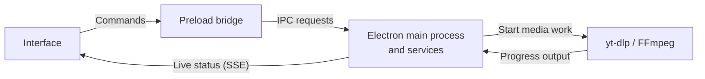

# Application architecture

Freedom Loader is an Electron desktop app, but its interface is not a page that talks directly to every part of the computer. It is split into a visible interface, a narrow bridge, and a background process that owns system-level work. A small Express server serves the interface locally and carries live download updates back to it.

Thinking of these parts as **the screen, the doorway, and the coordinator** makes the design easier to follow:

- The **renderer** is the screen: it displays the form, preview, settings, and progress.
- The **preload bridge** is the doorway: it exposes specific actions the screen is allowed to request.
- The **Electron main process** is the coordinator: it handles application lifecycle, windows, settings, operating-system features, and IPC requests.
- The **Express server and services** provide the local web page and perform backend work such as downloads and metadata lookups.

## What happens when the app opens

The main process waits for Electron to be ready, then prepares the application in stages. It checks packaged native dependencies, may start the yt-dlp updater, starts the local Express server, registers IPC handlers, loads themes, and creates the main window. The splash screen reports progress during this startup sequence. The window is shown only after the local page has loaded.

Express binds to `127.0.0.1:8787` and serves the files in `public/`. The `BrowserWindow` loads that local page. This means the interface is delivered as a web page, but the web page is still part of the desktop application running on the user's computer.

## How the interface asks the app to do work

The renderer cannot use Node.js APIs directly: its window has `nodeIntegration` disabled and `contextIsolation` enabled. Instead, `preload.js` uses Electron's context bridge to expose a set of named APIs, such as `window.downloadAPI`, `window.infoAPI`, and `window.themeAPI`.

When the user starts a download, for example, the renderer calls `window.downloadAPI.startDownload(options)`. The preload API turns that request into an IPC message. A handler in the main process validates and routes it to the relevant controller or service. The result is returned to the renderer as a promise. This boundary keeps the interface focused on user interaction while the main process retains responsibility for privileged work.

## Why there is both IPC and a local server

IPC is used for **one-off actions and their results**: requesting video information, starting or cancelling a download, selecting a folder, or asking for available themes. These requests travel directly between the renderer and the Electron main process through the preload bridge.

The local Express server has two jobs:

1. Serve the static interface to the BrowserWindow.
2. Provide Server-Sent Events (SSE) routes that keep a connection open while the renderer receives changing download status.

The SSE routes carry progress, speed, processing-stage, and playlist-item updates. They do not carry the download request itself; that request uses IPC. Keeping the streams separate lets the renderer receive updates while the long-running download request is still in progress.

## Where media work happens

The download service builds an argument list and launches the local yt-dlp executable with Node's `execFile`. yt-dlp does the site-specific extraction and transfer. FFmpeg is supplied for tasks such as merging separate audio and video streams, extracting MP3 audio, and embedding supported metadata or thumbnails. FFprobe is also included in the packaged media-tool dependencies and checked during startup.

Metadata preview is a separate operation from downloading. When **Auto Fetch Info** is enabled, the renderer asks the main process for information through `infoAPI`; the info service invokes yt-dlp in JSON mode and returns normalized video or playlist data. That lookup does not start a media download.

## Local data and external services

| What | How Freedom Loader uses it |
|---|---|
| Local application | Stores configuration and logs under Electron's user-data location; downloaded media goes to the selected or default download folder. |
| Source website | yt-dlp contacts the website in the URL to retrieve information or media. |
| Firefox | yt-dlp is configured to read Firefox cookies for sources that need the user's authenticated session. |
| GitHub | The app checks published releases for application updates. |
| Discord | Rich Presence can connect to Discord when enabled in the configuration. |

These are separate connections for separate features. In particular, playback or downloads do not pass through the documentation website or a Freedom Loader media server.

## Related guides

- [Download lifecycle](./download-lifecycle) follows one request from the form through yt-dlp and back to the progress display.
- [Video and playlist information](./video-information) explains the preview lookup.
- [Settings and files](./settings-and-files) describes configuration and user-data locations.
