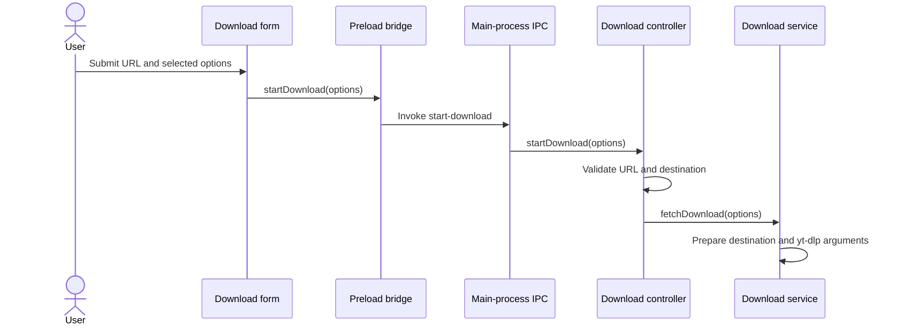
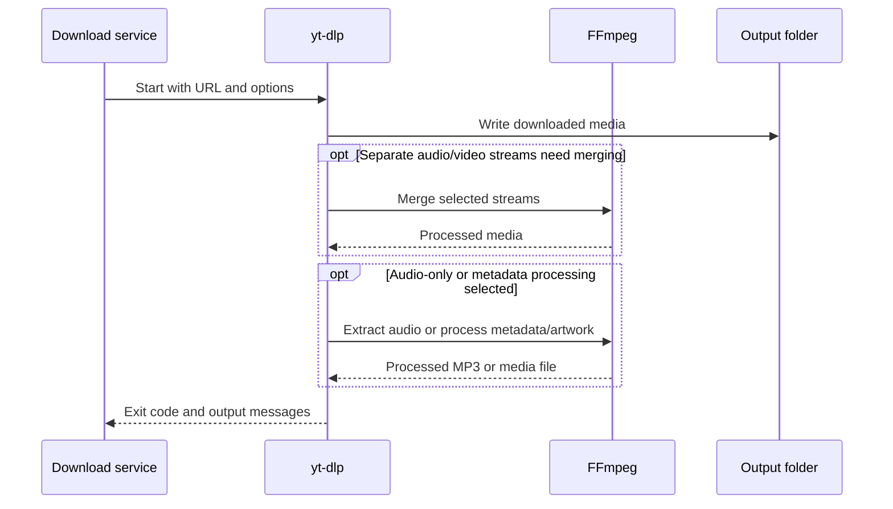
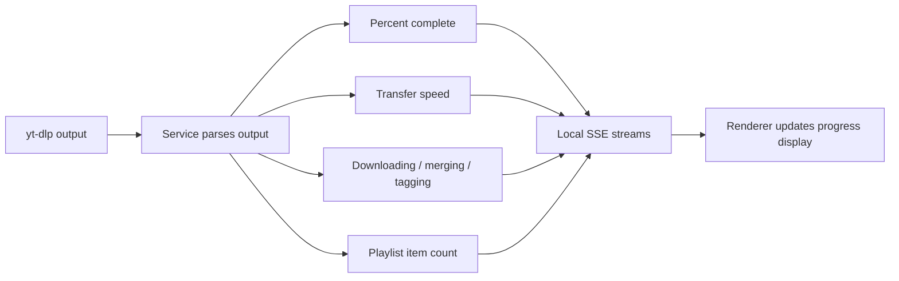
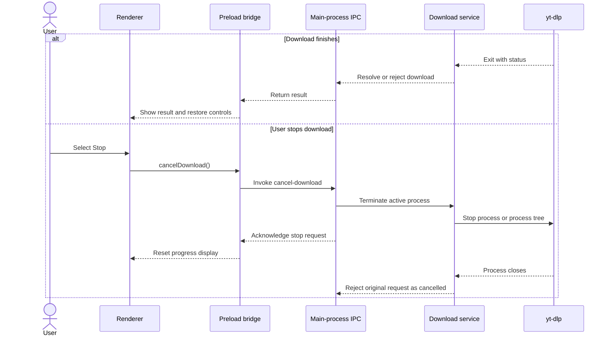

# Download lifecycle

A download is more than starting yt-dlp: Freedom Loader first prepares a request, then keeps the interface informed while a separate process works, and finally reports how that process ended. Following one download through those stages explains why the app uses both IPC and live event streams.

You can pan and zoom each diagram. Use its controls, drag to move it, or hold Ctrl (Cmd on macOS) while scrolling. Open a diagram in the expanded view if you need more room.

## 1. From the form to a prepared request

When the user submits the form, the renderer prevents a second submission, disables the download button, and shows an initial progress panel. It collects the form values and calls `window.downloadAPI.startDownload(...)` through the preload bridge. The request travels over Electron IPC; it is not sent to an internet-facing download API.

The controller checks that the URL can be parsed and that a supplied save path passes the app's path checks. It accepts the quality presets `best`, `medium`, `worst`, `1080`, `720`, and `480`; an unrecognized quality value is normalized to `best`. If no destination was supplied, the service uses the default Freedom Loader download folder.

For a playlist, the service can create a separate folder using the playlist title when **Create Playlist Folders** is enabled. The title is sanitized for use as a folder name and a numbered suffix is added if that name already exists. The service then builds the yt-dlp options from the request and current settings, including playlist behavior, selected format and quality, metadata preferences, and output filename template.

## 2. yt-dlp does the media work

The service launches yt-dlp as a child process using `execFile` with the executable and its arguments kept separate. yt-dlp handles the site-specific steps needed to retrieve the media. Depending on the selected mode and available streams, it may download separate streams, merge formats, extract MP3 audio, or process metadata and thumbnails with FFmpeg.

The actual steps depend on the source and user options. For example, audio-only mode asks yt-dlp to extract audio and convert it to MP3; video mode requests an MP4 merge. A requested video codec is a preference applied through yt-dlp's format sorting, not a promise that every source will provide that codec.

## 3. Progress travels back while the request is still running

The renderer opens four SSE connections to the local Express server: `/download/progress`, `/download/speed`, `/download/stage`, and `/download/playlist-info`. When yt-dlp writes output, the download service parses useful lines and sends updates to the controller, which publishes them on the corresponding stream.

Each stream carries one kind of information so the interface can update it independently. The percentage and speed describe the transfer reported by yt-dlp; stage messages describe later work such as merging or embedding metadata. Playlist messages show an item number when yt-dlp reports one. As a result, a transfer percentage reaching 100% does not necessarily mean all post-processing has finished.

If the page disconnects, its SSE request closes and the controller removes that stream's listener. The download process itself is managed by the main process and service, not by the page's event connection.

## 4. Completion, errors, and stopping

When yt-dlp exits, the service uses its exit code to determine whether the download completed. A zero exit code resolves the start-download request with the output folder. The controller can then show the configured system notification. A non-zero exit or a process stopped by the user rejects the request; the renderer reports an error where appropriate and restores the download controls.

The **Stop** button uses a separate IPC action from the still-running start request. It asks the service to terminate the active yt-dlp process; Windows uses `taskkill` to stop the process tree, while other platforms attempt to stop the detached process group. The cancel action acknowledges the stop request, and the original start request then completes with a cancellation error when the child process closes.

## What can affect the result

- **Source availability:** yt-dlp must be able to access the URL and retrieve the requested formats. Some sources require a logged-in session; the app asks yt-dlp to use Firefox cookies.
- **Quality and format:** A quality preset is a maximum or selection rule applied to formats available from the source; it cannot create a stream that is not available.
- **Post-processing tools:** Merging, audio conversion, and metadata or thumbnail processing depend on the bundled FFmpeg binary.
- **Playlist settings:** Playlist detection and playlist download behavior are controlled by the URL and current settings. Folder creation and filename ordering can be enabled separately.
- **Metadata options:** Metadata and thumbnail embedding follow the current settings and the formats supported by yt-dlp/FFmpeg.

For information previews before starting a download, see [Video and playlist information](./video-information). For the larger process and IPC boundaries, see [Application architecture](./architecture).
