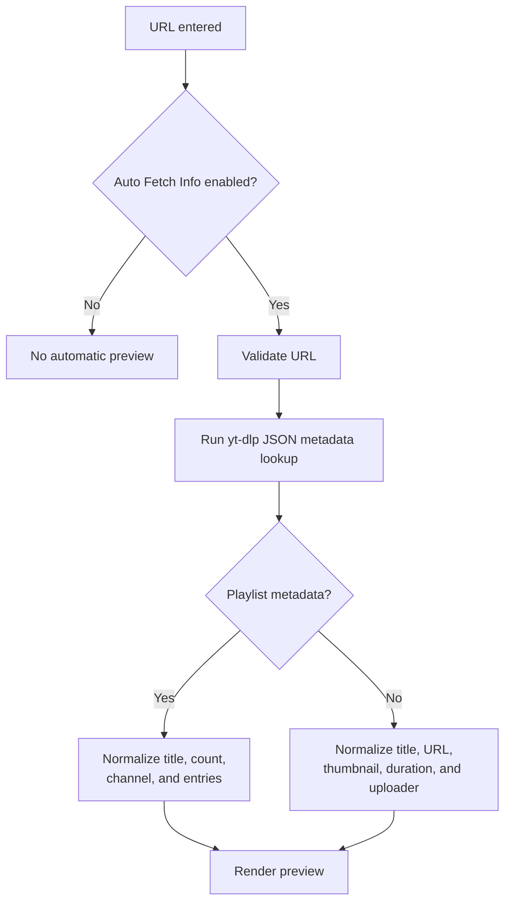

# Video and playlist information

When **Auto Fetch Info** is enabled, entering a URL triggers a metadata lookup. This is a preview only: yt-dlp runs in JSON mode and the application does not start a media download as part of this lookup.

The information service requests a single JSON response from yt-dlp and uses Deno as a JavaScript runtime. It allows up to 30 seconds for the request. For playlist URLs, the lookup includes playlist entries. If playlist extraction fails, the service retries the URL without its playlist query parameters; a one-item playlist is displayed as a video.

## Video preview

The normalized video information includes its title, page URL, thumbnail, duration, channel/uploader, approximate file size, upload date, and other metadata when the source provides it. Some fields are absent on some sites, so a preview may show unknown or incomplete values.

## Playlist preview

Playlist results include the playlist title, uploader/channel, entry count, and a simplified list of entries. For entries that provide a video ID, the interface creates a YouTube watch URL; otherwise it uses the entry URL supplied by yt-dlp.

Playlist recognition for download options is a URL heuristic: the app checks for `?list=`, `&list=`, or `@`. It is not a universal playlist detector for every service.

## Authenticated sources

The yt-dlp commands request cookies from Firefox. Freedom Loader checks common Firefox installation paths on Windows and Linux; it does not currently offer a browser selector. If a site requires a logged-in session, sign in with Firefox first. Cookie access can fail when Firefox is running or its profile database is unavailable.

Only use your own browser session, and only download content that you are allowed to access and save.
