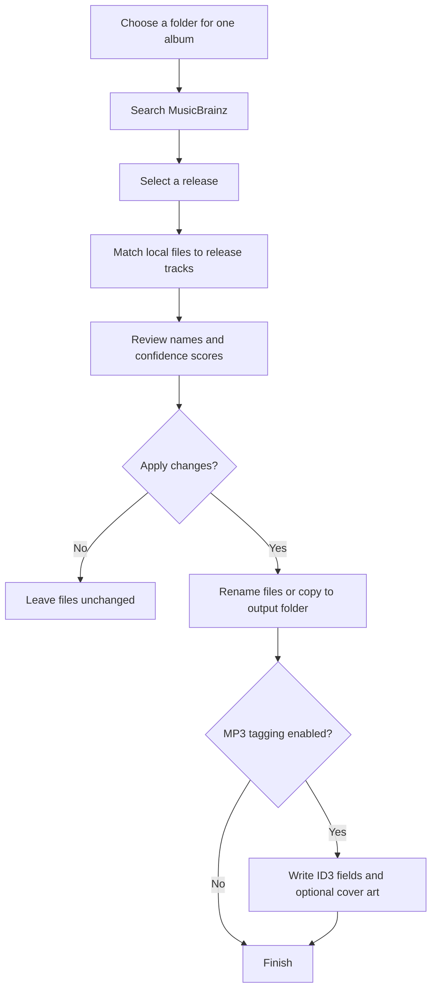

# Freedom Tagger

Freedom Tagger is an external command-line tool created to provide richer MP3 metadata than Freedom Loader currently offers. It looks up a release in [MusicBrainz](https://musicbrainz.org/), matches the release's track titles to local audio filenames, and can write detailed ID3 tags and embed the release cover.

## Why Freedom Tagger exists

Freedom Loader can download audio as MP3, but its current MP3 metadata is not yet as complete or high-quality as desired. Freedom Tagger was developed as a separate CLI tool to fill that gap: it uses MusicBrainz release and track data to identify album tracks, then applies consistent titles, artist and album names, track numbers, release year, and cover art to MP3 files.

For now, use Freedom Tagger independently on the downloaded files. It does not currently run from inside Freedom Loader or integrate with its interface. Keeping it external makes the improved metadata workflow available now, while leaving open the possibility of bringing it into the main project later.

:::info
 Designed for one album at a time
 Tagger expects a folder containing the tracks of one mostly sorted album or single. It is not intended to identify and organize a large mixed music library.
:::

## What it does

- Searches MusicBrainz using an album name and, optionally, an artist name.
- Offers up to five releases to choose from, including edition details such as date, country, and track count.
- Matches local tracks against the selected release and displays a confidence score before making changes.
- Can rename tracks using the official title and track position.
- Can write title, artist, album, track number, and year ID3 fields to MP3 files.
- Can embed release cover art from the Cover Art Archive or use a custom image.
- Can preview proposed filenames with `--dry`, or write results to a separate directory with `--output`.

## Typical workflow

 

Use `--dry` to inspect the proposed matches without changing files. Without `--output`, confirming the operation renames matched files in the source folder. With `--output`, Tagger copies matched files to that destination and applies filenames and supported tags there, leaving the source files in place.

## Start using it

See [Standalone installation and usage](./usage) for setup, command options, and safe example commands. See [Matching, metadata, and limitations](./matching-and-limitations) for how confidence scores are produced and which file formats can be tagged.

## Project source

Freedom Tagger is maintained separately from Freedom Loader: [MasterAcnolo/Freedom-Tagger on GitHub](https://github.com/MasterAcnolo/Freedom-Tagger).
